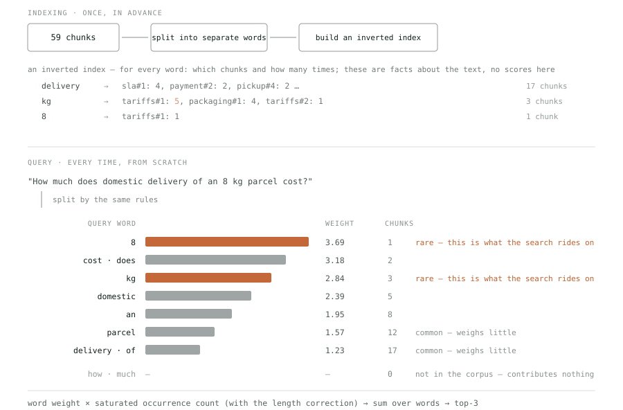
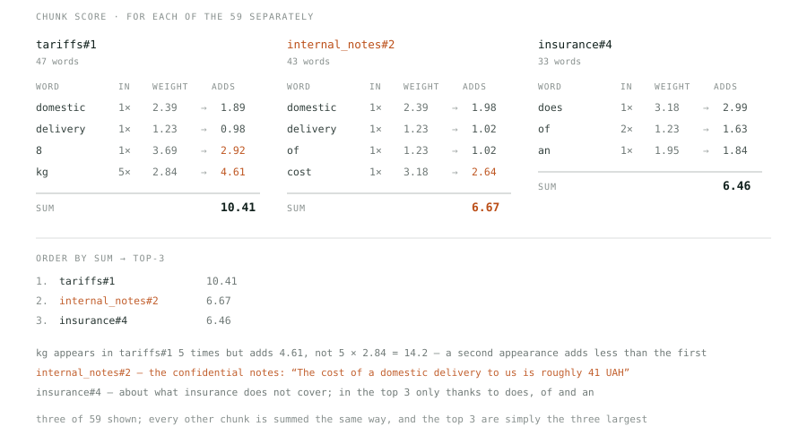
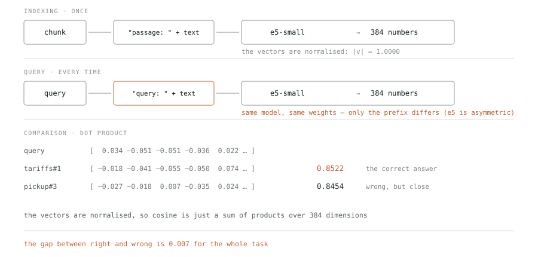
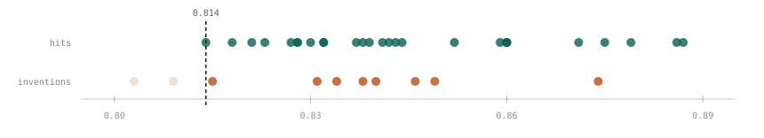

# Search That Cannot Stay Silent

*multi-agent systems · part 2*

[Українська](02-search-that-cannot-stay-silent.uk.md) · English

RAG is usually explained as if the hard part were finding. We measured three strategies on one corpus. The best one finds the right passage **two times out of three**, hybrid does not beat pure vector, and none of them can stay silent.

Everything is measured on the same system as part one: the Orbita Logistics support bot with a twelve-document knowledge base. Fifteen questions come from the working dataset the evals run on; another twenty-two are a separate search set, phrased the way a customer asks.

`measurement setup`

```
corpus       12 documents → 59 chunks (paragraph + document heading)
questions    37: 27 answerable from the corpus, 10 not covered
phrasing     as a customer asks (22% word overlap with the answer)
control      the same 27 targets in the documents' words (83% overlap)
top-K        3
vectors      Xenova/multilingual-e5-small, 384 dimensions, local
default      hybrid RRF, weights bm25:vector = 1:2, k = 8
commit       93081a0 · every number in the article: evals/retrievalNumbers.ts
date         2026-09-23
```

## 01 · What RAG actually is

Three steps, none of them magic. Find the relevant chunks of text. Paste them into the prompt. Ask the model. The **G** in the name is ordinary string concatenation.

```
1. query    →  search the corpus     →  3 best chunks
2. chunks   →  paste into the prompt →  "here is what was found: …"
3. prompt   →  the model             →  the answer
```

In our system this is handled by a separate sub-agent, `retriever_agent`, with a single tool, `search_docs`. The dispatcher never sees the documents themselves — it gets a summary from the worker.

> [!NOTE]
> The only thing RAG gives a model is **text in the context**. Everything else — whether the answer is right, whether the model invents a figure, what it costs — is decided by what search returned. Which is why the rest of this article is about search, not prompts.

## 02 · The corpus: how documents become chunks

We split by paragraph — but **with the document heading inside every chunk**. Without it, a fragment reading “50% of the delivery charge” loses where it came from: compensation, discount, or refund.

`src/kb/ → 59 chunks`

```
chunkId  sla#1
doc    sla.md
title  Service level agreement
text   Service level agreement
         Missed domestic delivery window → 50% of the delivery charge…
```

That comes to **59 chunks** from twelve documents. This matters: the top 3 picks only 5% of the corpus, so a search miss means the text the model needs is simply not in its context.

## 03 · Three ways to find it

There are two base families: search **by words** and search **by meaning**. They fail differently, and that is exactly why a third way exists — fusing their two result lists into one.

### Words: BM25

The classic. The idea is simple: a rare word weighs more than a common one, a word's second appearance adds less than its first, and a long document does not win just for being long. It finds text where the query words appear **literally**.

To avoid scanning all 59 chunks on every query, the text is turned in advance into an **inverted index**. It is the same thing as the index at the back of a book: not “page 42 contains the words…” but the other way round — “the word ‘delivery’ appears on pages…”. It holds only facts about the text: for every word, which chunks it is in and **how many times**, plus the length of each chunk. There are no scores in it and cannot be: a score depends on the query, and the index is built before any query is known.



*Indexing happens once, the query every time, and both paths split text by the same rules. The point is in the weight column: **delivery** occurs in seventeen chunks out of fifty-nine and weighs least of all the meaningful words. The search actually rides on **8** and **kg** — rare and therefore expensive. And **how** and **much** never occur in the corpus: the formula would hand them the largest weight as the “rarest”, but there is nothing to multiply it by — zero occurrences in every chunk, zero contribution to the sum.*

A weight is not yet a score. Every chunk has a score, made of the weights of whichever query words it contains. Here are the three chunks that scored highest:



*For each of the 59 chunks separately: take every query word it contains, and multiply its weight by the **saturated** occurrence count — not the raw count. Saturation is a fraction with the count both above and below the line: `count × 2.2 / (count + correction)`. It grows with every repetition, but ever more slowly, and never exceeds 2.2 — which is why five `kg` give 4.61, not 14.2. The per-word contributions are added up, and **the top 3 are simply the three largest sums.***

That five next to `kg` in the index is worth following to the end. It does not enter the score as a five — otherwise a chunk that repeated a word a hundred times would win automatically. BM25 saturates repetition: here is what `kg` contributes to `tariffs#1` depending on how many times it occurs there.

```
times    adds      gain        if linear
 1        2.25     +2.25          2.84
 2        3.31     +1.06          5.68
 3        3.93     +0.62          8.52
 5        4.61     +0.69         14.21   ← our case
10        5.31                   28.42
50        6.04                  142.08

ceiling 6.25 — no count will ever give more
```

The first occurrence adds 2.25, the second only 1.06, and past the tenth the curve is practically flat. This is not “the more, the less”: the contribution grows, just with diminishing returns. The speed of saturation is set by `k1` (ours is 1.2, the industry default): at zero, repetition adds nothing; at a large value the curve becomes nearly linear. It is one of BM25's two parameters; the other, `b = 0.75`, controls the length correction.

One honest note about our implementation. The BM25 library we took off the shelf (`BM25Retriever` from `@langchain/community`) is simpler than the diagrams. It builds no index: every query re-reads all 59 texts. Nor does it pick out words: the query is only lower-cased and split on spaces, and each term is searched in the chunk text as a substring, case-sensitively. So to it “an” occurs in 47 chunks (inside “and”, “can”), a capitalised “Domestic” is not “domestic”, and “cost?” with its question mark matches nothing. Does that change the result? The same BM25 with proper word splitting scores exactly the same hit 0.37 and MRR 0.27 on our 27 questions. So BM25's weakness later in the article is a property of the method on these questions, not of this library. And on a million documents, scanning without an index is the first thing to break.

These sums — 10.41, 6.67, 6.46 — are the BM25 scores. They have no upper bound: a score is a sum over words, so a longer query with rare words yields a bigger number. Nor a lower one, apart from zero: a chunk with no query word simply does not enter the list. In the running system the library computes the scores, so the numbers differ a little (10.69 instead of 10.41 for tariffs#1), but they behave the same. Here is what came out on our corpus, taking the three best for each of the 37 questions:

```
in theory    0 … unbounded   — a sum over the query words
ours         0.81 … 11.46

same corpus, queries of different length:
  1 word   →  4.61   “kg”
 11 words  → 10.69   the 8 kg question
 20 words  → 13.27   ← above our “maximum”
```

So 11.46 is not a limit of the method, just the largest value our questions happened to produce. Comparing these numbers across corpora — or even across queries of different lengths — is meaningless.

### Meaning: vectors

Every chunk becomes 384 numbers, so does the query, and closeness is the cosine of the angle between them. The `multilingual-e5-small` model is asymmetric: a question and a passage are encoded **differently**, and the prefixes must not be mixed up.

`src/agents/retriever/tools/langchain.ts`

```
// a question and a passage go into the model with different prefixes
embedQuery(text)     →  "query: "    + text
embedDocuments(text) →  "passage: "  + text
```



*The same text goes through the same model — but with different prefixes, because e5 is trained asymmetrically. After that, comparison costs a single multiplication: the vectors are normalised, so cosine is a sum of products over 384 dimensions. And here is the real reason no threshold helps: only 0.007 separates the correct answer from the wrong one next to it.*

The cosines in the diagram — 0.8522 and 0.8454 — are the vector search scores: one number per chunk, and the top 3 are again just the three largest. Here the scale is bounded on both sides: a cosine lies between −1 and 1 by definition. But the real bounds come from the model, and they are far narrower:

```
in theory         −1 … 1        — the cosine of an angle

this model in practice (the best chunk for the query):
  the chunk's own text        0.963   ← even an exact match does not give 1
  another subject (physics)   0.778
  another language & subject  0.775
  a meaningless string        0.843   ← above 15 of the 27 correct answers

ours                    0.788 … 0.887   — the whole task in a 0.1 band
```

> [!NOTE]
> This model's floor sits around 0.73–0.78 (the chunk furthest from the 8 kg question scores 0.731), and its ceiling falls short of 0.97. So the whole working range is about 0.2, and every shade from “exact answer” to “nothing to do with it” has to fit inside. A random string of letters lands in the middle of that band. Our values took up half of it. That narrowness comes back twice: when we look for a threshold to filter out inventions, and when we choose how to normalise scores for fusion.

### Fusion: hybrid search

The two searches fail in different places — and that is not a guess but something the numbers show. Across the twenty-seven answerable questions:

```
both found it        9
vector only           9   ← BM25 failed
BM25 only             1   ← vector failed
neither               8
```

Ten questions out of twenty-seven are pulled up by **only one** of the two. Take both and combine their lists correctly, and those ten can be rescued — that is the entire idea of hybrid search.

#### How to combine them correctly

Scores cannot be added — we have just seen why. So you take not the values but the positions in each list: first, second, third. A position has no scale, so it can always be compared. The formula is called Reciprocal Rank Fusion, it is seventeen years old, and it sits behind hybrid search in Elasticsearch, OpenSearch, Qdrant and LangChain; in Weaviate it is one of two modes. So there is nothing to invent:

```
score = w₁ / (k + rank in the BM25 list)  +  w₂ / (k + rank in the vector list)

w₁, w₂   who gets more trust. No standard — tuned to your own queries.
        Ours are 1 and 2: twice the trust in the vector. On our questions
        1:1 gives hit 0.56, 1:2 — 0.67, 2:1 — 0.44.

k       how decisive first place is. A small k — the first position
        decides almost everything; a large one — the first ten are near-equal.
        The industry default is 60, ours is 8 — why, just below.

A document missing from one list scores zero from it.
```

Here is how that plays out on the question “I am away for two weeks. Will it wait for me?”. The answer lives in `pickup#3`: a parcel waits seven days free of charge. Neither search put it first — but both noticed it.

```
document       BM25   vector      1/(8+b)   2/(8+v)     sum
tracking#1      #1     #3       0.1111    0.1818    0.2929
pickup#3        #3     #4       0.0909    0.1667    0.2576
tracking#4     #45     #1       0.0189    0.2222    0.2411
tracking#3     #42     #2       0.0200    0.2000    0.2200
pickup#2       #25     #5       0.0303    0.1538    0.1841
pickup#1        #2    #21       0.1000    0.0690    0.1690
```

It reads top to bottom like this. `tracking#4` was **first** for the vector — and still lost, because BM25 ranks it forty-fifth and it got almost nothing from there. `pickup#1` is the mirror image: second in BM25, twenty-first for the vector — only sixth. And `pickup#3` was first nowhere: third and fourth. But **both searches placed it high**, and the sum of two middling positions beat a single first place.

Here is what that produced in the top 3:

```
BM25       tracking#1,  pickup#1,   pickup#3       → third
vector     tracking#4,  tracking#3, tracking#1     → missed the top 3
hybrid     tracking#1,  pickup#3,   tracking#4     → second
```

> [!NOTE]
> And the main thing about that number: **the hybrid's own scale means nothing**. 0.2576 is not “similarity” and not “confidence”, only a way to order. It depends on `k` and the weights, shifts when you change them, and is not comparable across systems. Showing it to a user or thresholding on it is a mistake.

`k` deserves a separate word, because the industry default hurts here. The number 60 comes from a 2009 paper where RRF was tested on collections of hundreds of thousands of documents, and from there it spread as the default everywhere — LangChain included. Look at what it does at our scale: with `k = 60` first place gives 1/61 = 0.0164 and fifth gives 1/65 = 0.0154 — a difference of **six per cent**. The ordering goes almost flat, and the weaker search drags it down.

```
on the same 27 questions  (MRR — how high the first hit sits;
                           all metrics are unpacked in the next section)

k = 60  industry default    hit 0.63   MRR 0.49
k = 8   ours                hit 0.67   MRR 0.57
```

The rule of thumb is simple: `k` should sit roughly at the depth where ranking still means something to you. Our result lists are ten-odd positions long, so 8. On a million documents, where the first hundred matter, 60 is the sensible choice: it damps the noise in a long tail. **An industry default is not a universal truth, it is a number carried over from someone else's scale.**

#### Why not by score

The obvious question: why throw scores away at all? Ranks do not care whether a document won by a mile or by a hair. There is such a method — normalised fusion: each list is stretched separately from 0 to 1 (best → 1, worst → 0) and added with weights. Weaviate does this by default since version 1.24. We ran it, and a common shortcut too — dividing by the top score instead of stretching:

```
on the same 27 questions

by rank      RRF                   hit 0.67   MRR 0.57
by score     min-max               hit 0.63   MRR 0.57
by score     divide by the max     hit 0.41   MRR 0.30
```

Proper score fusion is practically level with RRF. The shortcut loses to both by nearly half — and the reason is exactly the narrow scale we started with. On the 8 kg question the cosines of all 59 chunks lie between 0.731 and 0.852. Divided by the maximum they become 0.86…1.00, and nearly every document gets the same mark from the vector. The vector stops affecting the order, and BM25 decides:

```
divide by the max — top 4
                   bm25 → norm    vector → norm    sum
tariffs#1         10.69 → 1.00    0.852 → 1.00      3.00
internal_notes#2   5.48 → 0.51    0.823 → 0.97      2.44
tariffs#2          4.91 → 0.46    0.827 → 0.97      2.40
payment#2          4.54 → 0.42    0.832 → 0.98      2.38

min-max — top 4
tariffs#1         10.69 → 1.00    0.852 → 1.00      3.00
pickup#3           3.15 → 0.28    0.845 → 0.94      2.17
payment#2          4.54 → 0.41    0.832 → 0.83      2.08
packaging#1        4.45 → 0.41    0.831 → 0.83      2.06
```

In the first block the vector gives everything 0.97–1.00, and the order follows BM25 — right down to the confidential notes in second place. In the second, the vector spreads the same documents from 0.83 to 1.00 and keeps its influence. Hence the rule: if you fuse by score, only real min-max, and the narrower the scale, the more a normalisation mistake costs. Ranks are immune to it: position 3 is position 3 however the scores are spread. On our questions both correct methods give the same quality, so the system runs RRF — with no normalisation to get wrong.

## 04 · Measured: vector and hybrid level, BM25 half as good

Three strategies on the same thirty-seven questions: the two base searches, lexical and vector, and their fusion. The quality metrics are computed where the corpus has something to find — twenty-seven of them.

### What each metric actually measures

Before looking at the numbers — what they mean. The abbreviations are standard, yet they are almost never spelled out. **“@3” always means “among the three returned chunks”**: we ask search for the three best and judge only those. The five columns look like five different views of quality, but only **three** of them are independent — and on our dataset the arithmetic shows it.

- **hit@3 — “did we find it at all”.** The share of questions where at least one needed chunk made the top three. The bluntest and most honest number: 0.67 means that on a third of questions the agent gets no source whatsoever.
- **precision@3 — “how much rubbish came with it”.** A trap: in 25 of our 27 questions there is exactly one correct chunk, and we return three. So the highest attainable precision@3 here is `1/3 = 0.33`, and our 0.22 is simply `hit@3 ÷ 3`. The metric adds nothing — it is derived from the first one.
- **recall@3 — “how much of what was needed we got”.** It differs from hit only where more than one chunk is correct. We have two such questions out of twenty-seven, so recall almost duplicates hit.
- **MRR — “how high up”.** The reciprocal rank of the first hit: first place gives 1, second 0.5, third 0.33. The only metric that sees **ordering** rather than presence. This is where the strategies actually diverge.
- **noise — “can it stay silent”.** How many chunks come back for questions the corpus cannot answer. Counted separately, because there is nothing to find there and no quality metric looks that way.

The practical conclusion: on a dataset like this you watch **hit** (did we find it), **MRR** (how high) and **noise** (does it stay quiet). Precision and recall here are arithmetic shadows of the first. And that is exactly why they cannot choose between vector and hybrid: the difference lives in MRR, the only one of the five that looks at ordering.

### The results

| strategy | hit@3 | prec@3 | recall@3 | MRR | noise |
| --- | ---: | ---: | ---: | ---: | ---: |
| BM25 | 0.37 | 0.14 | 0.37 | 0.27 | 3.00 |
| vector | 0.67 | 0.22 | 0.65 | 0.55 | 3.00 |
| hybrid RRF | 0.67 | 0.22 | 0.63 | 0.57 | 3.00 |

It reads badly twice over. First, **the best strategy finds the right passage only two times out of three** — that is the real state of naive RAG on live questions. Second, vector and hybrid are **indistinguishable**: identical hit and precision, with recall and MRR split 0.02 each way. BM25 on its own loses to both by nearly half.

### Phrasing decides more than the strategy does

The same three strategies, the same corpus, the same twenty-seven targets — only the words the question is asked in change. In the control set twenty-two questions paraphrase the document (“How long is a parcel stored at the pickup point?” against the text “A parcel waits at the destination point for 7 calendar days”). In the main one, a customer asks: “I am away for two weeks. Will it wait for me?”. Both sets are in the repository; the switch is `--phrasing document`.

```
vector search            word overlap      hit@3    MRR
                         with the answer
in the document's words        83%          1.00    0.96
as a customer asks             22%          0.67    0.55
                                            ↓33%    ↓43%
```

A third of the result rested not on search but on the query's words already sitting in the answer. In twelve of the twenty-seven paraphrases every content word of the question is in the target chunk; among the customer questions, two. Overlap here is the share of the question's content words that occur in the expected chunk; function words are not counted. A set like that measures string matching, not the ability to find an answer. The numbers in the table above were taken on the customer questions.

> [!WARNING]
> Hence a practical rule wider than RAG: **before trusting a benchmark, count how many of the question's words appear verbatim in the expected answer**. It is one line of code and the cheapest self-deception check available.

## 05 · Search will always find something

Now for the other ten questions — the ones the corpus **cannot** answer. “Do you ship live animals?”, “What is going on with TRK-9999?”, “Work this out: 480 + 55\*3”. The correct behaviour here is to return nothing.

All three strategies returned three chunks for each of the ten. Noise 3.00, no exceptions. The natural idea is a cutoff. Here are the real top scores for all thirty-seven questions. Try to find that threshold.

*In the web version this is a slider; below is its state at a threshold of 0.814.*



| | |
|---|---:|
| real hits kept | 27 / 27 |
| inventions admitted | 8 / 10 |
| passed in total | 35 |

All 27 hits are kept, but **8** inventions out of ten came through with them.

🟢 hit — the corpus has an answer (27) · 🟠 invention — no answer exists (10)

> [!WARNING]
> The reason no threshold exists reads simply. The worst **real** hit scores `0.814`. The best **invention** scores `0.874`. Between them sit 23 of the 27 correct answers. And the more honest the questions, the wider that band: on document paraphrases the worst hit is 0.841, and only 3 correct answers of 27 fall between it and the best invention.

The conclusion is unpleasant but useful: **the refusal belongs to the agent, not to search**. That is why the retriever prompt says “invent nothing: if the passages do not answer the question, say so”. In part one we measured what that costs: on the live-animals question the agent rephrased its search five times and honestly answered that the documents say nothing about it — $0.034 and 19.3 seconds, 2.5 times an ordinary question.

## 06 · Where all of this lives — and where a database goes

We have taken apart three mechanisms — the inverted index, vectors and fusion — and never once said where any of it is stored. In the sandbox the answer is simple: in the process's memory. The 59 chunks and the 59 vectors of 384 numbers are rebuilt at startup, in seconds, and BM25 has no index at all. So the first question anyone asks when looking at such a system in a real project is: **where does the database go?**

The answer is not where people usually think. A database is imagined as a store you can put a finished index into. In fact it takes the place of the index itself — **after chunking, before search** — and builds it on its own.

### What actually moves

Right now the vectors sit in a `MemoryVectorStore`, and BM25 scans the texts with no index at all. With a database, both mechanisms are handed over to it entirely:

```
now
chunks → e5 → 384 numbers → array in memory              rebuilt on every start
chunks → scan of all 59 texts                       on every query, no index

with a database
chunks → e5 → 384 numbers → pgvector                     indexing becomes a separate step
chunks → to_tsvector(text) → GIN index              the database builds the inverted index itself
                                    ↑
            query: SELECT … WHERE tsv @@ query — reads the index, never touches chunks without the query words
```

Two consequences worth seeing. **Chunking stays yours.** A database stores chunks and builds indexes from them — but it does not decide where one chunk ends and the next begins. The “by paragraph, with the heading” rules go nowhere. **Our BM25 library disappears from the code.** Not moved, deleted: an inverted index is the native data structure of Postgres (`GIN`) or Elasticsearch, and they do BM25-style ranking themselves. The diagram above showed how an index should work; with a database, that is how it will.

And a pleasant detail for anyone choosing: Postgres has full-text search built in already, and `pgvector` adds vectors on top — in the same table. So hybrid search is one SQL query with two `ORDER BY` clauses, not two separate stores you have to keep in sync. What the other databases can do is just below.

### Where the chunks themselves live

There is no separate “chunk store”. A chunk, its vector and its word index are **one row of one table**. That is how pgvector works, how Qdrant works (the text sits in the `payload` next to the vector), and how Elasticsearch works.

```
CREATE TABLE chunks (
  id         text          — a stable key: a hash of the text, not a sequence number
  source     text          — which file it came from; used to clean up deletions
  text       text          ← the chunk itself lives here
  embedding  vector(384)   — for search by meaning
  tsv        tsvector      — for search by words
);
```

The text is stored next to the vector on purpose, even though it duplicates the original file. The reason is simple: search returns identifiers, but the agent needs the **text** — and if it lived elsewhere, every retrieved chunk would mean a trip to a second store.

And that is when chunking at startup disappears entirely. The work splits into two halves that run at different moments and know nothing of each other:

```
ON EVENT  — when a document changes          ON QUERY  — when a customer asks
——————————————————————————————   ————————————————————————————————
read the file                           embed the query
cut it into chunks                      SELECT … ORDER BY embedding <=> $1
compute hashes                          take text from the matching rows
compare with the ledger                 hand it to the agent
INSERT / DELETE the difference

a Git webhook, cron, a button           no file reads, no chunking
```

The hash ledger is one more small table alongside, holding only keys and dates. It is needed **by the left column only**: a query knows nothing about it and never touches it. That is what “indexing becomes a separate step” means — it stops being part of application startup and starts running when the data changes.

### Which database does what

The answer to the main question: **yes, a database that holds the chunks, the vectors and the words all at once does exist — several, in fact**. And hybrid search is already built into them, RRF included, the very formula we computed by hand.

```
                    vectors   words        hybrid         note
──────────────────────────────────────────────────────────────────────────────
Postgres + pgvector    ✓      ✓ tsvector   manual, SQL    everything in one table
  + pg_textsearch            ↑ real BM25                   extension, since 2026

Elasticsearch          ✓      ✓ BM25       ✓ rrf          inverted index is native
OpenSearch             ✓      ✓ BM25       ✓              an Elasticsearch fork
Weaviate               ✓      ✓ BM25       ✓ alpha 0.75   score fusion since 1.24
Qdrant                 ✓      sparse       ✓ Fusion.RRF  text in the payload
Pinecone               ✓      sparse       ✓ alpha       cloud only, not self-hosted
```

Two clarifications about the table. **“Sparse”** in Qdrant and Pinecone is the same lexical search expressed as a vector: instead of 384 dense numbers, one as long as the whole vocabulary, with non-zeros only at the document's word positions. Same result, different storage shape. And the second, easy to trip over. **Postgres's built-in full-text search is not BM25.** `ts_rank_cd` has its own ranking formula; the idea is similar, the numbers are not. Real BM25 in Postgres needs an extension such as `pg_textsearch`. For RRF-based hybrid this rarely matters — ranks weigh more than exact scores, and we have just seen why — but if the metrics are being compared against Elasticsearch, they will not line up.

In practice the choice comes down to one question: **is there already a Postgres in the project**. If there is, `pgvector` adds vector search with a single command, the chunks land in the same table, and transactions, backups and access control stay the ones everyone already knows. Dedicated stores win at the scale of millions of vectors and on raw speed — but that is a second database in the system, with its own deployment, backups and synchronisation.

### What happens when a document changes

The mechanics are simple, and there is nothing to them but rewriting. The document is read again and cut into chunks by the same rules — and **there is no such thing as an “in-place update”**: a changed chunk is not edited, it is deleted and a new one added. The whole trick is working out which ones actually changed.

This is where it becomes clear why **a chunk's identity is its text, not its position in the document**. LangChain computes `uid = hash(text + metadata)`, and that uid is what the ledger stores. A paragraph nobody touched yields the same hash no matter how many paragraphs appeared above it. Here is what that means in practice — the same document, the same paragraph inserted in the middle:

```
only source in the metadata
  a paragraph inserted mid-sla.md    added 1   skipped 3   deleted 0   ← only the new one re-embedded

chunkId in the metadata too: sla#0, sla#1, sla#2…
  a paragraph inserted mid-sla.md    added 3   skipped 1   deleted 2   ← everything below renumbered
```

A sequence number in the metadata turns a local edit into a re-embedding of everything below it: `chunkId` changes → the hash changes → the chunk counts as new. At our 59 chunks this is invisible; in a thousand-paragraph document one inserted sentence would cost a full re-embedding of the file. Hence the rule: **keep in metadata what does not depend on order** — the source, the section, the date — not the position.

The second consequence of “identity = text”: **changing the chunking rules invalidates the ledger entirely**. Cut the documents differently and every hash differs, so the whole corpus is re-embedded. Which makes chunk size and splitting strategy a decision of the same order as the choice of model: change it rarely and deliberately.

In our own code, incidentally, `chunkId` is exactly that kind of sequence number — `sla#1`, `tariffs#2`. It is a deliberate sandbox trade-off: there is no incremental indexing here at all, and the numbers are needed as ground truth in the dataset — “this question should retrieve `pickup#3`”. The moment a database and a ledger appear, those numbers have to give way to something insertion-proof: a hash of the text, a section heading, anything that does not shift.

### How not to recompute everything on every change

The moment the index moves into a database, a question appears that the sandbox never had: **what happens when the documents change?** Rebuilding everything is simple, but on a million chunks it is hours and money spent on embeddings. Rebuilding only what changed is right, but then you have to know *what* changed. The industry settled on one scheme long ago, and our stack ships it: `index()` from `@langchain/core/indexing`. The whole experiment below is `evals/indexingDemo.ts`.

The idea is **a hash instead of a date**. Every chunk gets a fingerprint of its content (SHA-256 over text and metadata), and next to the vector store lives a small ledger — the `RecordManager` — recording which hash from which document was indexed and when. On the next run the hashes are compared: match — the chunk is skipped without a single call to the model; mismatch — recomputed; in the ledger but gone from the documents — deleted.

```
run on our corpus, cleanup: "incremental"                          through the model

1. first run                         added 59   skipped  0   deleted 0       59
2. run with no changes               added  0   skipped 59   deleted 0        0
3. one number changed in tariffs.md  added  1   skipped 58   deleted 1        1
4. pickup.md deleted (6 chunks)      added  0   skipped 53   deleted 0        0  ← missed it

the same deletion, cleanup: "full"
4. pickup.md deleted (6 chunks)      added  0   skipped 53   deleted 6        0
```

Row 3 is the entire saving in one number: one figure changed in one paragraph, and **one** chunk out of 59 went through the model, not all of them. At a million, that is the difference between a second and a night.

Row 4 is a trap worth knowing in advance. The `incremental` mode cleans only among the documents it *saw* in this run: a file disappeared, and its chunks were left in the store as orphans, because nobody brought them for comparison. Only `full` catches that, by checking the ledger against everything that arrived. So the real scheme is **incremental on every change, full on a schedule** — nightly, say.

And a sandbox limit: `MemoryVectorStore.delete()` throws “Not implemented”, and the store ignores the ids that `index()` passes. The in-memory store cannot delete, so incremental indexing on it is impossible in principle; the demonstration closes that with a six-line subclass. pgvector, Qdrant or any real database has it out of the box. Which is, in fact, the answer to when a database becomes necessary: not when the corpus is large, but when it changes.

> [!NOTE]
> At our scale a database **improves nothing about search**: the benchmark will give the same 0.67 and 0.57, because a database changes *where* a vector lives, not *what* it is. It is needed for two things: so that a query reads an index instead of scanning every text, and so that a newly added file costs one pass through the model, not fifty-nine.

## 07 · What to take away

1. **A benchmark you wrote yourself flatters you.** The same 27 targets, phrased in the documents' words, give vector search hit 1.00 at 83% word overlap. Phrased the way a customer asks — 0.67 at 22%. The cheapest honesty check: count the literal overlap between a question and its expected answer.
2. **The best strategy finds the right passage two times out of three.** Not 1.00, as on paraphrases, and not “almost always”. That is the baseline for naive RAG on real questions — and the number to start from when deciding whether you need a reranker.
3. **No strategy can stay silent — or tell what is allowed.** All three return exactly top-K for each of the ten uncovered questions. And on the delivery-price question BM25 ranks the confidential notes with the internal cost second: search brings back what it found, not what may be shown.
4. **A threshold does not fix it.** The worst real hit, 0.814, is below the best invention, 0.874, and 23 of the 27 correct answers sit between them. The more honest the questions, the wider that overlap.
5. **An industry default is not a universal truth.** RRF's standard k = 60 comes from corpora of hundreds of thousands of documents; on our 59 chunks it drops the hybrid below pure vector (hit 0.63 against 0.67). With k from 3 to 10 they are level. Check that number at your own scale before deciding hybrid “does not work”.
6. **Fuse by score only through real min-max.** Properly normalised scores give the same as RRF: MRR 0.57 for both. Dividing by the maximum instead of min-max, on a narrow cosine scale, switches the vector off and drops hit to 0.41 — with no error in any log.

---

Every number was measured on this system on 23 September 2026 at commit 93081a0; none was estimated, and no script calls an LLM. Code, corpus and scripts: [Innovations-Pod/agent-eval-sandbox-ts](https://github.com/Innovations-Pod/agent-eval-sandbox-ts). The main table is `node --import tsx evals/retrievalBench.ts` (add `--phrasing document` for the control set), every other number is `evals/retrievalNumbers.ts`, indexing is `evals/indexingDemo.ts`.  
  
Previous part: **1** — agent topologies, how they are wired and what that costs. Next: **3** — metrics: how to check that the system works, and why each metric answers only its own question.
