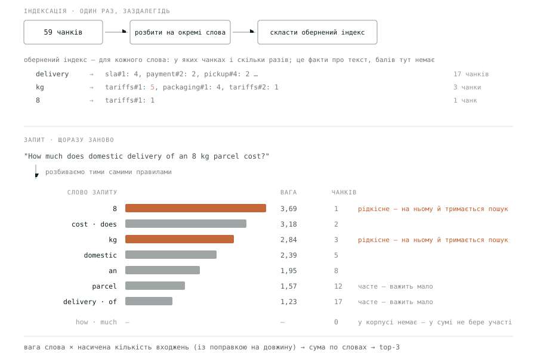
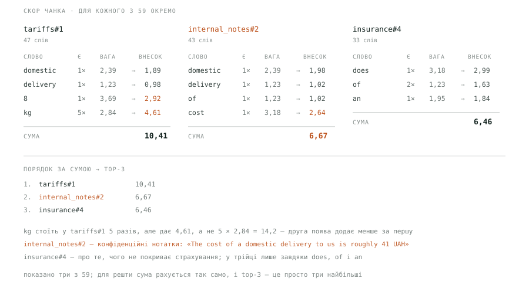
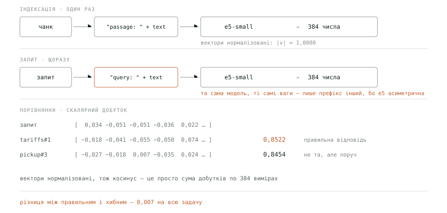
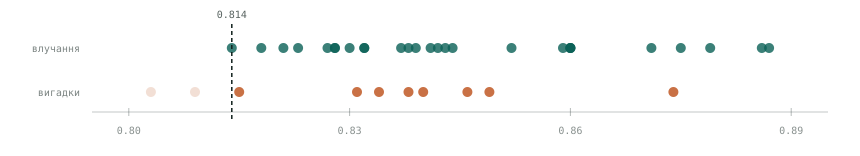

# Пошук, який не вміє мовчати

*мульти-агентні системи · частина 2*

[English](02-search-that-cannot-stay-silent.en.md) · Українська

RAG зазвичай пояснюють так, ніби складне в ньому — знайти. Ми виміряли три стратегії на одному корпусі. Найкраща знаходить потрібне **у двох випадках із трьох**, гібрид не виграє в чистого вектора, а мовчати не вміє жодна.

Усе виміряно на тій самій системі, що й у першій частині: бот підтримки «Орбіта Логістик», база знань із дванадцяти документів. П'ятнадцять питань — із робочого датасету, на якому ганяються еволи; ще двадцять два — окремий набір для пошуку, сформульований так, як питає клієнт.

`умови вимірювання`

```
корпус       12 документів → 59 чанків (абзац + заголовок документа)
питання      37: 27 із відповіддю в корпусі, 10 без покриття
формулювання як питає клієнт (перекриття слів із відповіддю 22%)
контроль     ті самі 27 цілей словами документа (перекриття 83%)
top-K        3
вектори      Xenova/multilingual-e5-small, 384 виміри, локально
дефолт       гібрид RRF, ваги bm25:vector = 1:2, k = 8
коміт        93081a0 · кожне число статті: evals/retrievalNumbers.ts
дата         23.09.2026
```

## 01 · Що таке RAG насправді

Три кроки, і жоден із них не магічний. Знайти релевантні чанки тексту. Вставити їх у промпт. Запитати модель. Літера **G** у назві — це звичайна конкатенація рядків.

```
1. запит   →  пошук по корпусу       →  3 найкращі чанки
2. чанки  →  підставити в промпт    →  "ось що знайдено: …"
3. промпт  →  модель                 →  відповідь
```

У нашій системі за це відповідає окремий суб-агент `retriever_agent` з єдиним інструментом `search_docs`. Диспетчер самих документів не бачить ніколи — він отримує від виконавця вже переказ.

> [!NOTE]
> Єдине, що RAG додає моделі, — **текст у контексті**. Усе інше — чи буде відповідь правильною, чи вигадає модель цифру, скільки це коштуватиме — вирішується тим, що повернув пошук. Тому далі стаття про пошук, а не про промпти.

## 02 · Корпус: як документи стають чанками

Ділимо по абзацах — але **з заголовком документа в кожному чанку**. Без цього фрагмент «50% вартості доставки» втрачає те, звідки він: чи це компенсація, чи знижка, чи повернення.

`src/kb/ → 59 chunks`

```
chunkId  sla#1
doc    sla.md
title  Service level agreement
text   Service level agreement
         Missed domestic delivery window → 50% of the delivery charge…
```

Виходить **59 чанків** із дванадцяти документів. Це важливо: top-3 відбирає лише 5% корпусу, тож промах пошуку означає, що потрібного тексту в контексті моделі просто не буде.

## 03 · Три способи знайти

Базових сімейств два: шукати **за словами** й шукати **за сенсом**. Вони ламаються по-різному, і саме тому існує третій спосіб — злити їхні видачі в одну.

### Слова: BM25

Класика пошуку. Ідея проста: рідкісне слово важить більше за часте, друга поява слова в тексті додає менше за першу, а довгий документ не виграє тільки тому, що довгий. Знаходить те, де слова запиту стоять **буквально**.

Щоб не перебирати всі 59 чанків на кожен запит, текст заздалегідь перетворюють на **обернений індекс**. Це те саме, що предметний покажчик у кінці книжки: не «сторінка 42 містить слова…», а навпаки — «слово „доставка“ зустрічається на сторінках…». У ньому лише факти про текст: для кожного слова — у яких чанках воно є і **скільки разів**, плюс довжина кожного чанка. Балів там немає й бути не може: бал залежить від запиту, а індекс будується до того, як запит відомий.



*Індексація проходить один раз, запит — щоразу, і обидва шляхи розбивають текст однаковими правилами. Головне в стовпчику ваг: **delivery** зустрічається у сімнадцяти чанках із п'ятдесяти дев'яти й важить найменше з усіх змістовних слів. Пошук насправді тримається на **8** і **kg** — рідкісних і тому дорогих. А **how** і **much** у корпусі не трапляються жодного разу: формула дала б їм найбільшу вагу як «найрідкіснішим», але множити її нема на що — нуль входжень у кожному чанку, нуль внеску в суму.*

Вага — це ще не скор. Скор має кожен чанк, і складається він із ваг тих слів запиту, які в цьому чанку є. Ось три чанки, що набрали найбільше:



*Для кожного з 59 чанків окремо: береться кожне слово запиту, яке в ньому є, і його вага множиться на **насичену** кількість входжень — не на саму кількість. Насичення це дріб, де кількість стоїть і зверху, і знизу: `разів × 2,2 / (разів + поправка)`. Він росте з кожним повторенням, але дедалі повільніше, і ніколи не перевищить 2,2 — тому п'ять `kg` дають 4,61, а не 14,2. Внески по словах додаються, і **top-3 — це просто три найбільші суми.***

Ту п'ятірку біля `kg` в індексі варто простежити до кінця. У скор вона входить не як п'ятірка — інакше чанк, де слово повторили сто разів, автоматично вигравав би. BM25 зрізає повторення: ось внесок `kg` у `tariffs#1` залежно від того, скільки разів воно там стоїть.

```
разів    внесок    приріст     якби лінійно
 1        2,25     +2,25          2,84
 2        3,31     +1,06          5,68
 3        3,93     +0,62          8,52
 5        4,61     +0,69         14,21   ← наш випадок
10        5,31                   28,42
50        6,04                  142,08

стеля 6,25 — більше не дасть ніяка кількість
```

Перше входження дає 2,25, друге — вже лише 1,06, а після десятого крива практично плоска. Це не «чим більше, тим менше»: внесок росте, просто з віддачею, що спадає. Швидкістю насичення керує параметр `k1` (у нас 1,2, галузевий дефолт): при нулі повторення не додають нічого, при великому значенні крива стає майже лінійною. Це один із двох параметрів BM25; другий, `b = 0,75`, керує поправкою на довжину.

Одна чесна примітка про нашу реалізацію. Бібліотека BM25, яку ми взяли з коробки (`BM25Retriever` з `@langchain/community`), влаштована простіше, ніж на схемах. Індексу вона не будує: на кожен запит заново гортає всі 59 текстів. І слів вона не виділяє: запит лише переводиться в нижній регістр і ріжеться за пробілами, а в тексті чанка шукається як підрядок і з урахуванням регістру. Тому для неї «an» трапляється в 47 чанках (усередині «and», «can»), «Domestic» з великої літери — не «domestic», а «cost?» зі знаком питання не знаходиться ніде. Чи змінює це результат? Той самий BM25 із правильним поділом на слова дає на наших 27 питаннях рівно ті самі hit 0,37 і MRR 0,27. Тож слабкість BM25 далі в статті — властивість методу на таких питаннях, а не цієї бібліотеки. А на мільйоні документів перебір без індексу — перше, що зламається.

Ці суми — 10,41, 6,67, 6,46 — і є скори BM25. Верхньої межі в них немає: скор — це сума по словах, тож довший запит із рідкісними словами дасть більше число. Немає й нижньої, крім нуля: чанк без жодного слова запиту просто не потрапляє у видачу. У робочій системі скори рахує бібліотека, тож числа трохи інші (для tariffs#1 — 10,69 замість 10,41), але поводяться так само. Ось що вийшло на нашому корпусі, якщо взяти по три найкращі з кожного з 37 питань:

```
теоретично   0 … без межі   — сума по словах запиту
у нас        0,81 … 11,46

той самий корпус, запити різної довжини:
  1 слово  →  4,61   «kg»
 11 слів   → 10,69   питання про 8 кг
 20 слів   → 13,27   ← вище за наш «максимум»
```

Тобто 11,46 — не межа методу, а просто найбільше, що трапилось на наших питаннях. Порівнювати ці числа між різними корпусами чи навіть між запитами різної довжини не можна.

### Сенс: вектори

Кожен чанк перетворюється на 384 числа, запит — теж, і близькість міряється косинусом кута між ними. Модель `multilingual-e5-small` асиметрична: питання й документ кодуються **по-різному**, і плутати префікси не можна.

`src/agents/retriever/tools/langchain.ts`

```
// питання й документ ідуть у модель з різними префіксами
embedQuery(text)     →  "query: "    + text
embedDocuments(text) →  "passage: "  + text
```



*Той самий текст проходить ту саму модель — але з різними префіксами, бо e5 навчена асиметрично. Далі порівняння коштує одне множення: вектори нормалізовані, тож косинус — це сума добутків по 384 вимірах. І ось справжня причина, чому порогом нічого не відсікти: між правильною відповіддю й найближчою хибною всього 0,007.*

Косинуси зі схеми — 0,8522 і 0,8454 — і є скори векторного пошуку: одне число на кожен чанк, і top-3 знову просто три найбільші. Тут шкала обмежена з обох боків: косинус за визначенням лежить від −1 до 1. Але реальні межі задає модель, і вони значно вужчі:

```
теоретично        −1 … 1        — косинус кута

ця модель на практиці (найкращий чанк для запиту):
  текст самого чанка          0,963   ← навіть точний збіг не дає 1
  чужа тема (фізика)          0,778
  інша мова, інша тема        0,775
  беззмістовний набір букв    0,843   ← вище, ніж у 15 із 27 правильних відповідей

у нас                   0,788 … 0,887   — уся задача в смузі 0,1
```

> [!NOTE]
> Підлога в цієї моделі — близько 0,73–0,78 (найдальший від питання про 8 кг чанк має 0,731), стеля не дотягує до 0,97. Тобто весь робочий діапазон — близько 0,2, і в нього треба вмістити всі відтінки від «точна відповідь» до «зовсім не про те». Випадковий набір букв при цьому опиняється посередині смуги. Наші значення зайняли її половину. Ця вузькість озветься двічі: коли шукатимемо поріг для відсіювання вигадок і коли вибиратимемо, як нормалізувати скори для злиття.

### Злиття: гібридний пошук

Два пошуки помиляються в різних місцях — і це не припущення, а те, що видно в цифрах. На двадцяти семи питаннях із відповіддю:

```
обидва знайшли       9
лише вектор           9   ← BM25 не впорався
лише BM25             1   ← вектор не впорався
ніхто                 8
```

Десять питань із двадцяти семи витягує **лише один** із двох. Якщо взяти обидва й правильно поєднати їхні видачі, ці десять можна врятувати — у цьому вся ідея гібридного пошуку.

#### Як поєднати правильно

Складати скори не можна — це ми щойно бачили. Тому беруть не значення, а позиції у видачі: перший, другий, третій. Позиція не має шкали, тож порівнювати її можна завжди. Формула називається Reciprocal Rank Fusion, їй сімнадцять років, і вона стоїть за гібридним пошуком в Elasticsearch, OpenSearch, Qdrant і LangChain; у Weaviate це один із двох режимів. Тобто вигадувати нічого не треба:

```
score = w₁ / (k + позиція у видачі BM25)  +  w₂ / (k + позиція у видачі вектора)

w₁, w₂   кому більше довіри. Стандарту немає — підбирають під свої запити.
        У нас 1 і 2: вектору вдвічі більше. На наших питаннях
        1:1 дає hit 0,56, 1:2 — 0,67, 2:1 — 0,44.

k       наскільки вирішальне перше місце. Мале k — перша позиція
        вирішує майже все; велике — перші десять майже рівні.
        Галузевий дефолт 60, у нас 8 — чому, одразу нижче.

Документ, якого в одній із видач немає, отримує з неї нуль.
```

Ось як це спрацьовує на питанні «I am away for two weeks. Will it wait for me?». Потрібна відповідь лежить у `pickup#3`: посилка чекає сім днів безкоштовно. Жоден із двох пошуків не поставив її першою — але кожен помітив.

```
документ       BM25   вектор      1/(8+b)   2/(8+v)     сума
tracking#1      #1     #3       0,1111    0,1818    0,2929
pickup#3        #3     #4       0,0909    0,1667    0,2576
tracking#4     #45     #1       0,0189    0,2222    0,2411
tracking#3     #42     #2       0,0200    0,2000    0,2200
pickup#2       #25     #5       0,0303    0,1538    0,1841
pickup#1        #2    #21       0,1000    0,0690    0,1690
```

Читається згори вниз так. `tracking#4` був у вектора **першим** — і все одно програв, бо в BM25 він аж сорок п'ятий і звідти отримав майже нуль. `pickup#1` навпаки: другий у BM25, двадцять перший у вектора — лише шостий. А `pickup#3` не був першим ніде: третій і четвертий. Але **обидва пошуки поставили його високо**, і сума двох середніх позицій перемогла одну першу.

Ось що з цього вийшло у видачі top-3:

```
BM25       tracking#1,  pickup#1,   pickup#3       → третім
вектор     tracking#4,  tracking#3, tracking#1     → не потрапив у трійку
гібрид     tracking#1,  pickup#3,   tracking#4     → другим
```

> [!NOTE]
> І головне про це число: **власна шкала гібрида нічого не означає**. 0,2576 — це не «подібність» і не «впевненість», а лише спосіб упорядкувати. Вона залежить від `k` і ваг, змінюється при їх правці й не порівнянна між системами. Показувати таке користувачеві чи ставити на нього поріг — помилка.

Про `k` варто сказати окремо, бо галузевий дефолт тут шкодить. Число 60 узяте зі статті 2009 року, де RRF перевіряли на колекціях у сотні тисяч документів, і звідти розійшлося дефолтом усюди — зокрема в LangChain. Подивись, що воно робить на нашому масштабі: при `k = 60` перша позиція дає 1/61 = 0,0164, а п'ята 1/65 = 0,0154 — різниця **шість відсотків**. Порядок стає майже пласким, і слабший пошук тягне вниз.

```
на тих самих 27 питаннях  (MRR — наскільки високо стоїть перше влучання;
                           усі метрики розібрані в наступній секції)

k = 60  галузевий дефолт    hit 0,63   MRR 0,49
k = 8   наше                hit 0,67   MRR 0,57
```

Орієнтир простий: `k` має бути приблизно на рівні глибини, де для тебе ще є сенс у ранжуванні. У нас видача — десяток позицій, тож 8. На мільйоні документів, де дивляться перші сто, 60 навпаки розумне: воно гасить шум у довгому хвості. **Галузевий дефолт — не універсальна істина, а число, перенесене з чужого масштабу.**

#### Чому не за скорами

Напрошується питання: а чому взагалі викидати скори? Адже рангам байдуже, документ виграв із запасом чи ледь-ледь. Є й такий спосіб — нормалізоване злиття: кожен список окремо розтягують від 0 до 1 (найкращий → 1, найгірший → 0) і додають із вагами. Так Weaviate робить за замовчуванням із версії 1.24. Ми прогнали і його, і поширене спрощення — ділити на найбільший скор замість розтягування:

```
на тих самих 27 питаннях

за рангами   RRF                   hit 0,67   MRR 0,57
за скорами   min-max               hit 0,63   MRR 0,57
за скорами   ділення на максимум   hit 0,41   MRR 0,30
```

Правильне злиття за скорами практично нарівні з RRF. А спрощене програє обом майже вдвічі — і причина рівно в тій вузькій шкалі, з якої ми почали. Косинуси всіх 59 чанків на питанні про 8 кг лежать між 0,731 і 0,852. Поділені на максимум, вони стають 0,86…1,00, і майже кожен документ отримує від вектора однакову оцінку. Вектор перестає впливати на порядок, і вирішує BM25:

```
ділення на максимум — top-4
                   bm25 → норм    vector → норм    сума
tariffs#1         10,69 → 1,00    0,852 → 1,00      3,00
internal_notes#2   5,48 → 0,51    0,823 → 0,97      2,44
tariffs#2          4,91 → 0,46    0,827 → 0,97      2,40
payment#2          4,54 → 0,42    0,832 → 0,98      2,38

min-max — top-4
tariffs#1         10,69 → 1,00    0,852 → 1,00      3,00
pickup#3           3,15 → 0,28    0,845 → 0,94      2,17
payment#2          4,54 → 0,41    0,832 → 0,83      2,08
packaging#1        4,45 → 0,41    0,831 → 0,83      2,06
```

У першому блоці вектор дає всім 0,97–1,00, і порядок повторює BM25 — аж до конфіденційних нотаток на другому місці. У другому вектор розкидає ті самі документи від 0,83 до 1,00 і тримає вплив. Звідси правило: якщо зливаєш за скорами — лише справжній min-max, і що вужча шкала, то дорожче коштує помилка в нормалізації. Ранги від неї застраховані: позиція 3 є позицією 3 незалежно від того, як розкидані скори. На наших питаннях обидва правильні способи дають однакову якість, тож у системі стоїть RRF — без нормалізації, яку можна зробити не так.

## 04 · Виміряно: вектор і гібрид нарівні, BM25 — удвічі слабший

Три стратегії на тих самих тридцяти семи питаннях: два базові пошуки — лексичний і векторний — і їх злиття. Метрики якості рахуються там, де в корпусі є що знаходити — на двадцяти семи з них.

### Що саме міряє кожен показник

Перш ніж дивитись на цифри — що вони означають. Скорочення тут стандартні, але їх майже ніколи не розшифровують. **«@3» скрізь означає «серед трьох повернутих чанків»**: ми просимо пошук повернути три найкращі й оцінюємо лише їх. П'ять колонок виглядають як п'ять різних поглядів на якість, але незалежних серед них **три** — і на нашому датасеті це видно з арифметики.

- **hit@3 — «чи знайшли взагалі».** Частка питань, де хоч один потрібний чанк потрапив у трійку. Найгрубіший і найчесніший показник: 0,67 означає, що на третині питань агент не отримає джерела зовсім.
- **precision@3 — «скільки сміття поруч».** Пастка: у 25 із 27 наших питань правильний чанк один, а повертаємо три. Тому максимально можлива precision@3 тут — `1/3 = 0,33`, і наші 0,22 це просто `hit@3 ÷ 3`. Показник нічого не додає — він похідний від першого.
- **recall@3 — «скільки з потрібного дістали».** Відрізняється від hit лише там, де правильних чанків більше одного. У нас таких питань два з двадцяти семи, тому recall майже дублює hit.
- **MRR — «наскільки високо».** Обернений ранг першого влучання: перше місце дає 1, друге 0,5, третє 0,33. Єдиний показник, який бачить **порядок**, а не факт наявності. Саме тут стратегії й розходяться.
- **шум — «чи вміє мовчати».** Скільки чанків повернуто на питаннях, де в корпусі немає відповіді. Рахується окремо, бо на них немає що знаходити, і жодна метрика якості туди не дивиться.

Практичний висновок: на такому датасеті дивитись треба на **hit** (чи знайшли), **MRR** (чи високо) і **шум** (чи мовчить). Precision і recall тут — арифметичні тіні першого. І саме тому вони не допомагають вибрати між вектором і гібридом: різниця сидить у MRR, який єдиний із п'яти дивиться на порядок.

### Результати

| стратегія | hit@3 | prec@3 | recall@3 | MRR | шум |
| --- | ---: | ---: | ---: | ---: | ---: |
| BM25 | 0.37 | 0.14 | 0.37 | 0.27 | 3.00 |
| векторний | 0.67 | 0.22 | 0.65 | 0.55 | 3.00 |
| гібрид RRF | 0.67 | 0.22 | 0.63 | 0.57 | 3.00 |

Читається неприємно двічі. По-перше, **найкраща стратегія знаходить потрібне лише у двох випадках із трьох** — це реальний стан наївного RAG на живих питаннях. По-друге, вектор і гібрид **нерозрізненні**: у них однакові hit і precision, а recall і MRR вони ділять по 0,02 у різні боки. BM25 наодинці програє обом майже вдвічі.

### Формулювання питання вирішує більше за стратегію

Ті самі три стратегії, той самий корпус, ті самі двадцять сім цілей — змінюється лише те, якими словами поставлене питання. У контрольному наборі двадцять два питання переказують документ («How long is a parcel stored at the pickup point?» проти тексту «A parcel waits at the destination point for 7 calendar days»). В основному — питає клієнт: «I am away for two weeks. Will it wait for me?». Обидва набори лежать у репозиторії, перемикач — `--phrasing document`.

```
векторний пошук          перекриття слів   hit@3    MRR
                         з відповіддю
словами документа              83%          1,00    0,96
як питає клієнт                22%          0,67    0,55
                                            ↓33%    ↓43%
```

Третина результату трималася не на пошуку, а на тому, що слова запиту вже стояли у відповіді. У дванадцяти питаннях-переказах із двадцяти семи кожне змістовне слово питання є в цільовому чанку; серед клієнтських таких два. Перекриття тут — частка змістовних слів питання, що трапляються в очікуваному чанку; службові слова не рахуються. Такий набір міряє збіг рядків, а не здатність знайти відповідь. Цифри в таблиці вище зняті на клієнтських питаннях.

> [!WARNING]
> Звідси практичне правило, ширше за RAG: **перш ніж вірити бенчмарку, порахуй, скільки слів питання дослівно збігається з очікуваною відповіддю**. Це один рядок коду й найдешевша перевірка на самообман, яку можна зробити.

## 05 · Пошук завжди щось знайде

А тепер про решту десять питань — ті, на які в корпусі відповіді **немає**. «Чи возите ви живих тварин?», «Що зі статусом TRK-9999?», «Порахуй 480 + 55\*3». Правильна поведінка пошуку тут — повернути порожньо.

Усі три стратегії повернули по три чанки на кожному з десяти. Шум 3,00 без винятків. Природна ідея — відсікти за порогом. Ось справжні найкращі скори всіх тридцяти семи питань. Спробуй знайти той поріг.

*У веб-версії це повзунок; нижче — його стан при порозі 0,814.*



| | |
|---|---:|
| влучань збережено | 27 / 27 |
| вигадок пропущено | 8 / 10 |
| усього пройшло | 35 |

Усі 27 влучань збережено, але разом з ними пройшло **8** вигадок із десяти.

🟢 влучання — у корпусі є відповідь (27) · 🟠 вигадка — відповіді немає (10)

> [!WARNING]
> Причина, чому порога не існує, читається просто. Найгірше **справжнє** влучання має скор `0,814`. Найкраща **вигадка** — `0,874`. Між ними сидять 23 правильні відповіді з 27. І що чесніші питання, то ширша ця смуга: на переказах документа найгірше влучання — 0,841, і між ним і найкращою вигадкою лише 3 правильні відповіді з 27.

Висновок неприємний, але корисний: **відмовлятися має не пошук, а агент**. Саме тому в промпті ретривера стоїть «нічого не вигадуй: якщо у фрагментах немає відповіді, так і скажи». У першій частині ми виміряли, чого це коштує: на питанні про живих тварин агент п'ять разів переформулював пошук і чесно відповів, що в документах про це нічого немає, — $0,034 і 19,3 секунди, у 2,5 раза дорожче за звичайне питання.

## 06 · Де в цьому все живе — і де буде база даних

Ми розібрали три механізми — обернений індекс, вектори і злиття — і жодного разу не сказали, де це все зберігається. У пісочниці відповідь проста: у пам'яті процесу. 59 чанків і 59 векторів по 384 числа будуються на старті заново, за секунди, а в BM25 індексу немає взагалі. Тому перше, що питають, дивлячись на таку систему в справжньому проєкті: **а база даних — вона де?**

Відповідь: не туди, куди зазвичай думають. Базу уявляють як сховище, куди можна покласти готовий індекс. Насправді вона сідає на місце самого індексу — **після розбиття на чанки, до пошуку** — і будує його сама.

### Що саме переїжджає

Зараз вектори лежать у `MemoryVectorStore`, а BM25 узагалі без індексу перебирає тексти. З базою обидва механізми віддаються їй цілком:

```
зараз
чанки → e5 → 384 числа → масив у пам'яті              будується на кожному старті
чанки → перебір усіх 59 текстів                  на кожен запит, без індексу

з базою
чанки → e5 → 384 числа → pgvector                     індексація — окремий крок
чанки → to_tsvector(text) → GIN-індекс             база будує обернений індекс сама
                                    ↑
            запит: SELECT … WHERE tsv @@ query — читає індекс, чанки без слів запиту не чіпає
```

Два наслідки, які варто побачити. **Розбиття лишається твоїм.** База зберігає чанки й будує з них індекси — але не вирішує, де проходить межа між чанками. Правила «по абзацах, із заголовком» нікуди не діваються. **Наша BM25-бібліотека зникає з коду.** Не переїжджає, а видаляється: обернений індекс — рідна структура даних Postgres (`GIN`) чи Elasticsearch, і ранжування на кшталт BM25 вони роблять самі. Схема вище показувала, як індекс має працювати; з базою він так і працюватиме.

І приємна деталь для тих, хто вибирає: у Postgres повнотекстовий пошук уже вбудований, а `pgvector` додає до нього вектори — в одну таблицю. Тобто гібридний пошук — це один SQL-запит із двома `ORDER BY`, а не два різні сховища, які треба тримати в синхроні. Що саме вміють інші бази — нижче.

### Де лежать самі чанки

Окремого «сховища чанків» не буває. Чанк, його вектор і його індекс слів — це **один рядок однієї таблиці**. Так влаштовані і pgvector, і Qdrant (там текст лежить у `payload` поруч із вектором), і Elasticsearch.

```
CREATE TABLE chunks (
  id         text          — стабільний ключ: хеш тексту, не порядковий номер
  source     text          — з якого файлу; за ним чистять видалене
  text       text          ← сам чанк лежить отут
  embedding  vector(384)   — для пошуку за сенсом
  tsv        tsvector      — для пошуку за словами
);
```

Текст зберігають поруч із вектором навмисно, хоч він і дублює оригінальний файл. Причина проста: пошук повертає ідентифікатори, а агенту треба віддати **текст** — і якби він лежав деінде, за кожним знайденим чанком довелося б іти в друге сховище.

І ось тоді нарізка на старті зникає зовсім. Робота розпадається на дві, які запускаються в різні моменти й не знають одна про одну:

```
НА ПОДІЮ  — коли документ змінився        НА ЗАПИТ  — коли клієнт щось спитав
——————————————————————————————   ————————————————————————————————
читаємо файл                            векторизуємо запит
ріжемо на чанки                        SELECT … ORDER BY embedding <=> $1
рахуємо хеші                            беремо text із знайдених рядків
порівнюємо з журналом                   віддаємо агенту
INSERT / DELETE різницю

вебхук із Git, cron, кнопка              жодного читання файлів, жодного різання
```

Журнал із хешами — це ще одна маленька таблиця поруч, лише з ключами й датами. Потрібна вона **лише лівій колонці**: запит про неї не знає й ніколи до неї не звертається. Саме в цьому й полягає «індексація стає окремим кроком» — вона перестає бути частиною запуску застосунку й починає запускатися тоді, коли дані змінились.

### Яка база що вміє

Відповідь на головне питання: **так, база, де живуть і чанки, і вектори, і слова, існує — і не одна**. Причому гібридний пошук у них уже вбудований, разом з RRF, який ми рахували вручну.

```
                    вектори   слова        гібрид         примітка
──────────────────────────────────────────────────────────────────────────────
Postgres + pgvector    ✓      ✓ tsvector   вручну, SQL    усе в одній таблиці
  + pg_textsearch            ↑ справжній BM25              розширення, з 2026

Elasticsearch          ✓      ✓ BM25       ✓ rrf          обернений індекс — рідний
OpenSearch             ✓      ✓ BM25       ✓              форк Elasticsearch
Weaviate               ✓      ✓ BM25       ✓ alpha 0,75   злиття за скорами з 1.24
Qdrant                 ✓      розріджені   ✓ Fusion.RRF  текст у payload
Pinecone               ✓      розріджені   ✓ alpha       хмара, не self-hosted
```

Два уточнення до таблиці. **«Розріджені»** у Qdrant і Pinecone — це той самий лексичний пошук, поданий як вектор: замість 384 щільних чисел береться довжиною в увесь словник, де ненульові лише позиції слів документа. Результат той самий, форма зберігання інша. І друге, на якому легко обпектися. **Вбудований у Postgres повнотекстовий пошук — це не BM25.** `ts_rank_cd` має власну формулу ранжування; ідея схожа, числа інші. Для справжнього BM25 у Postgres потрібне розширення на кшталт `pg_textsearch`. Для гібрида з RRF це зазвичай не критично — ранги важать більше за точні скори, і ми щойно бачили, чому, — але якщо метрики звіряються з Elasticsearch, вони не зійдуться.

Практично вибір зводиться до одного питання: **чи є вже Postgres у проєкті**. Якщо є — `pgvector` додає векторний пошук однією командою, чанки лягають у ту саму таблицю, а транзакції, бекапи й права доступу лишаються тими, до яких усі звикли. Спеціалізовані сховища виграють на масштабі від мільйонів векторів і на швидкості — але це вже друга база в системі, з власним розгортанням, бекапами й синхронізацією.

### Що відбувається, коли документ змінився

Механіка проста, і в ній немає нічого, крім перезапису. Документ читають заново, ріжуть на чанки за тими самими правилами — і **жодних «оновлень на місці» не буває**: змінений чанк не редагується, його видаляють і додають новий. Уся хитрість у тому, щоб зрозуміти, які саме змінились.

Тут і виявляється, чому **ідентичність чанка — це його текст, а не позиція в документі**. LangChain рахує `uid = hash(текст + метадані)`, і саме цей uid лежить у журналі. Абзац, який не чіпали, дає той самий хеш незалежно від того, скільки абзаців з'явилося вище. Ось що це означає на практиці — той самий документ, той самий вставлений посередині абзац:

```
у метаданих лише source
  вставили абзац у середину sla.md   додано 1   пропущено 3   видалено 0   ← перерахувався лише новий

у метаданих ще й chunkId: sla#0, sla#1, sla#2…
  вставили абзац у середину sla.md   додано 3   пропущено 1   видалено 2   ← перенумерувалось усе нижче
```

Порядковий номер у метаданих перетворює локальну правку на перевекторизацію всього, що нижче: змінився `chunkId` → змінився хеш → чанк вважається новим. На наших 59 це непомітно; на документі в тисячу абзаців одне вставлене речення коштувало б повного перерахунку файлу. Звідси правило: **у метаданих тримай те, що не залежить від порядку** — джерело, розділ, дату, — а не позицію.

Друге, що випливає з «ідентичність = текст»: **зміна правил чанкінгу знецінює журнал повністю**. Перерізав документи інакше — усі хеші інші, отже весь корпус перевекторизується. Тому розмір чанка й спосіб різання варто вважати рішенням того самого рівня, що й вибір моделі: змінювати рідко й свідомо.

У нашому коді, до речі, `chunkId` саме порядковий — `sla#1`, `tariffs#2`. Це свідомий компроміс пісочниці: інкрементальної індексації в ній немає взагалі, а номери потрібні як ground truth у датасеті — «на це питання має знайтись `pickup#3`». Щойно з'явиться база й журнал, ці номери доведеться замінити на щось стійке до вставок: хеш тексту, заголовок розділу, будь-що, що не зсувається.

### Як не перераховувати все на кожну зміну

Щойно індекс переїхав у базу, з'являється питання, якого в пісочниці не було: **що робити, коли документи змінюються?** Перебудувати все — просто, але на мільйоні чанків це години й гроші за векторизацію. Перебудувати лише змінене — правильно, але тоді треба знати, *що* змінилось. Галузь давно зійшлась на одній схемі, і в нашому стеку вона є з коробки: `index()` з `@langchain/core/indexing`. Увесь експеримент нижче — `evals/indexingDemo.ts`.

Ідея — **хеш замість дати**. Кожен чанк отримує відбиток свого вмісту (SHA-256 від тексту й метаданих), а поруч зі сховищем векторів живе маленька таблиця-журнал: `RecordManager`, у якій записано, який хеш із якого документа коли проіндексовано. На наступному прогоні хеші порівнюються: збігся — чанк пропускається без жодного звернення до моделі; не збігся — перераховується; є в журналі, але немає в документах — видаляється.

```
прогнали на нашому корпусі, cleanup: "incremental"                     через модель

1. перший запуск                     додано 59   пропущено  0   видалено 0      59
2. запуск без змін                   додано  0   пропущено 59   видалено 0       0
3. змінено одне число в tariffs.md   додано  1   пропущено 58   видалено 1       1
4. видалено pickup.md (6 чанків)    додано  0   пропущено 53   видалено 0       0  ← не помітив

те саме видалення, cleanup: "full"
4. видалено pickup.md (6 чанків)    додано  0   пропущено 53   видалено 6       0
```

Рядок 3 — це вся економія в одному числі: змінили одну цифру в одному абзаці, і через модель пройшов **один** чанк із 59, а не всі. На мільйоні це різниця між секундою й ніччю.

Рядок 4 — пастка, яку варто знати наперед. Режим `incremental` чистить лише серед документів, які він *побачив* у цьому прогоні: файл зник — і його чанки лишились у сховищі сиротами, бо їх ніхто не приніс на порівняння. Ловить це лише `full`, який звіряє журнал з усім, що прийшло. Тому реальна схема — **інкрементально при кожній зміні, повністю за розкладом**, наприклад раз на ніч.

І межа пісочниці: `MemoryVectorStore.delete()` кидає «Not implemented», а ідентифікатори, які передає `index()`, це сховище ігнорує. Сховище в пам'яті не вміє видаляти, тож інкрементальна індексація на ньому неможлива в принципі; у демонстрації це закрито підкласом на шість рядків. У pgvector, Qdrant чи будь-якій справжній базі це є з коробки. Ось, власне, і відповідь, коли база стає потрібною: не коли корпус великий, а коли він змінюється.

> [!NOTE]
> На нашому масштабі база **нічого не покращить у пошуку**: бенчмарк дасть ті самі 0,67 і 0,57, бо база міняє *де лежить* вектор, а не *який* він. Вона потрібна заради двох речей: щоб запит читав індекс замість перебору всіх текстів, і щоб докинутий файл коштував один прогін через модель, а не п'ятдесят дев'ять.

## 07 · Що з цього виносити

1. **Бенчмарк, який ти склав сам, тобі лестить.** Ті самі 27 цілей, сформульовані словами документа, дають векторному пошуку hit 1,00 при перекритті слів 83%. Так, як питає клієнт, — 0,67 при 22%. Найдешевша перевірка чесності: порахувати буквальне перекриття питання з очікуваною відповіддю.
2. **Найкраща стратегія знаходить потрібне у двох випадках із трьох.** Не 1,00, як на переказах, і не «майже завжди». Це базова лінія наївного RAG на живих питаннях — і саме з неї треба починати, вирішуючи, чи потрібен реранкер.
3. **Жодна стратегія не вміє мовчати — і не розрізняє дозволене.** Усі три повертають рівно top-K на кожному з десяти питань без покриття. А на питанні про ціну доставки BM25 ставить другими конфіденційні нотатки з внутрішньою собівартістю: пошук приносить те, що знайшов, а не те, що можна показувати.
4. **Порогом це не лікується.** Найгірше справжнє влучання 0,814 нижче за найкращу вигадку 0,874, і між ними сидять 23 правильні відповіді з 27. Що чесніші питання, то ширша смуга перекриття.
5. **Галузевий дефолт — не універсальна істина.** Стандартне k = 60 у RRF узяте з корпусів у сотні тисяч документів; на наших 59 чанках воно опускає гібрид нижче за чистий вектор (hit 0,63 проти 0,67). З k від 3 до 10 — нарівні. Перевір це число на своєму масштабі, перш ніж вирішувати, що гібрид «не працює».
6. **Зливати за скорами — лише через справжній min-max.** Правильно нормалізовані скори дають те саме, що RRF: MRR 0,57 в обох. Ділення на максимум замість min-max на вузькій шкалі косинусів вимикає вектор і опускає hit до 0,41 — без жодної помилки в логах.

---

Усі цифри виміряні на цій системі 23 вересня 2026 року на коміті 93081a0, жодна не оцінена на око, і жоден скрипт не звертається до LLM. Код, корпус і скрипти — [Innovations-Pod/agent-eval-sandbox-ts](https://github.com/Innovations-Pod/agent-eval-sandbox-ts). Головна таблиця — `node --import tsx evals/retrievalBench.ts` (з `--phrasing document` — контрольний набір), кожне інше число — `evals/retrievalNumbers.ts`, індексація — `evals/indexingDemo.ts`.  
  
Попередня частина: **1** — топології агентів, як з'єднують і чого це коштує. Наступна: **3** — метрики: як перевіряти, що система працює, і чому кожна метрика відповідає лише на своє питання.
